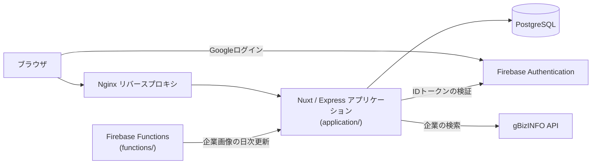

# no1-company-share

福井県の企業のうち、何らかの分野でNo.1の企業を投稿・共有するWebアプリケーションです。画面とAPIはNuxt（SSR）とExpressで動き、データはPostgreSQLに保存します。

## 主な機能

- 投稿の一覧表示（ログインしていなくても閲覧できる）
- Googleアカウントでのログイン（Firebase Authentication）
- 投稿の作成・編集・削除。企業はgBizINFOのAPIで福井県の法人から検索し、会社ホームページのOG画像を企業画像として表示する
- お気に入り登録と、お気に入り・自分の投稿の一覧表示
- 投稿の通報（通報された投稿は全ユーザーに表示されなくなる）

## システム構成



## 技術スタック

| 対象 | 技術 |
| --- | --- |
| 画面・API | Nuxt 4（Vue 3、Vuetify 4）、Express、TypeScript、Node.js 24 |
| 定期処理 | Firebase Functions（Node.js 22） |
| 認証 | Firebase Authentication |
| データベース | PostgreSQL（Sequelize） |
| 開発・インフラ | Docker、Docker Compose、Nginx |

## 開発環境のセットアップ

Docker Compose を利用して、アプリケーション・データベース・Web サーバを一括で起動できます。

### 1. 依存パッケージのインストール

```bash
# アプリケーション層の依存関係
cd application
yarn install

# Functions層の依存関係（必要に応じて）
cd ../functions/functions
npm ci
cd ../../
```

### 2. コンテナの起動

`docker-compose.yml` はデータベースの環境変数を `database/.env` から読み込むため、起動前にこのファイルを作成してください。データベースの初期化でロケールのエラーになる場合は、[document/docker.md](document/docker.md#postgresql) の `POSTGRES_INITDB_ARGS` を設定してください。プロジェクトルートで Docker Compose を起動します。

```bash
docker compose up
```

起動後、ローカル環境で画面および API にアクセスできます。

## 主なコマンド

```bash
# アプリケーションのテスト・静的解析
cd application
yarn test
yarn lint
yarn build

# Firebase Functions のテスト・静的解析
cd ../functions/functions
npm test
npm run lint
```

企業画像の日次更新は Firebase の `scheduledCompanyMasterUpdate` が日本時間0時に実行します。Function の Secret Manager とアプリ本番環境の `.env` に、同じ `COMPANY_UPDATE_SECRET` を設定してください。アプリの配備とは別に、`functions/` から対象 Function を配備する必要があります。値はリポジトリやログへ記録しないでください。

## 書き込みAPIの結合テスト

`application/` の `yarn test:integration` は実際のAPI・DI・PostgreSQLで保存、権限検証、ロールバックを確認します。Firebaseの本人確認だけをテスト用に置き換えます。

`database/init/` のスキーマを用意した使い捨てDBの接続URLを `NO1_TEST_DATABASE_URL` に設定して実行してください。接続先は localhost または 127.0.0.1、DB名は `codex_no1_` で始まる名前に限定されます。テスト用データを書き込むため、本番や普段の開発DBを指定しないでください。

## ディレクトリ構成

```text
no1-company-share/
├── application/             # Nuxt / Express Web アプリケーション
│   ├── front/               # Vue コンポーネント、Pinia ストア、静的アセット
│   ├── server/              # Express API サーバ、SSR 認証ロジック
│   └── common/              # 画面と API で共通の設定・ユーティリティ
├── functions/               # Firebase Functions（企業画像の日次更新）
├── database/                # DB 初期化スクリプト
├── document/                # API仕様の例、環境構築・本番環境のメモ
├── web/                     # Nginx の配信設定
└── docker-compose.yml       # 開発用マルチコンテナ設定
```
